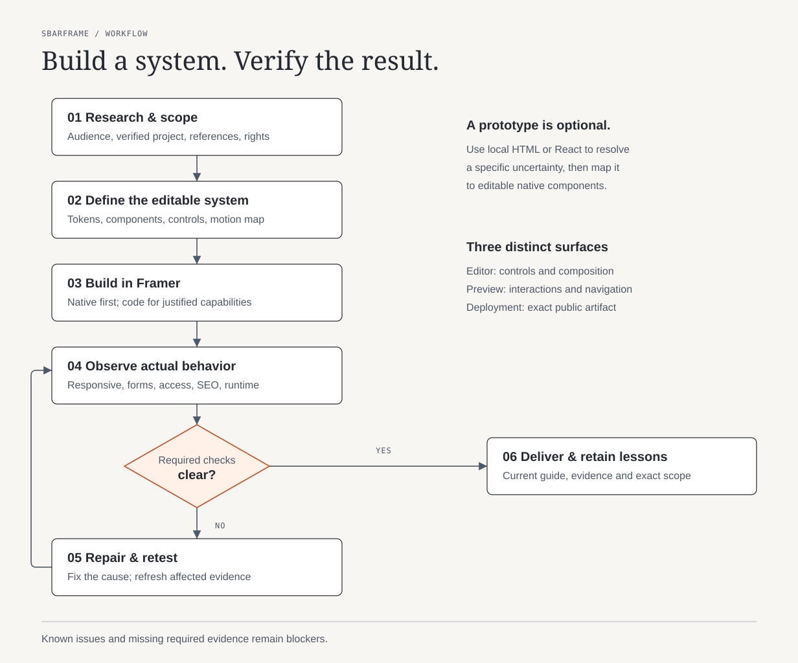
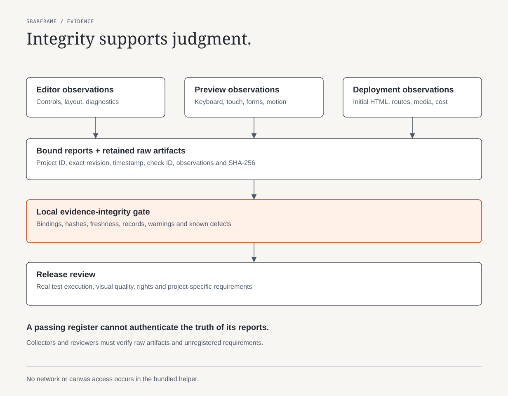

# sbarframe

**A Framer quality workflow for AI agents: research, reusable design, responsive behavior and evidence before delivery.**

[العربية](README.ar.md) · [Usage](docs/usage.md) · [Evidence guide](skills/sbarframe/references/gate.md) · [Contributing](CONTRIBUTING.md)



sbarframe helps an agent build and review an editable Framer site or component
system. It covers the failures that often survive a polished screenshot: broken
responsive layouts, incomplete forms, inconsistent components, excessive motion,
unmeasured media, missing SEO and undocumented customization.

It includes an installable skill, focused implementation references, reusable
project documents, component contracts and a tested evidence-register validator.
It is an independent community project. Connected work uses Framer's official tools.

## Install

```bash
npx skills add M7MMAD-OMAR/sbarframe --skill sbarframe
```

Choose your agent and project or global scope in the installer. Bun users can
run `bunx skills add M7MMAD-OMAR/sbarframe --skill sbarframe`.
See [manual installation and updates](docs/usage.md#installation).

Then ask your agent:

```text
Use sbarframe to build an editable Framer portfolio.
Research two creative directions, define shared components and motion,
and verify responsive behavior, accessibility, forms, SEO and performance.
Record what was actually tested and any remaining blockers.
```

For connected edits, first follow
[Framer's external-agent setup](https://www.framer.com/agents/external/).
Install and use its official execution skill. sbarframe coordinates quality;
it does not supply credentials or an editor connection.

## What it adds to a project

| Concern | Required work and evidence |
|---|---|
| Creative direction | Inspect relevant references, compare original concepts, verify asset rights |
| Editable system | Shared styles, named components, variants, buyer controls and documented contracts |
| Responsive layouts | Real geometry, phone/tablet/desktop, boundary widths and difficult content |
| Forms and CMS | Constraints, keyboard use, failure/retry, approved delivery tests and real detail routes |
| Motion | Coordinated triggers, static decisions, reduced motion and lifecycle cleanup |
| SEO and performance | Initial HTML, metadata, crawlable routes, delivered images and repeatable profiles |
| Delivery | Current documentation, issue history and revision-bound evidence |

## A workflow, plus an optional helper

The skill can guide a small repair without scaffolding an entire site. New
projects can use the local helper to create missing records without overwriting
existing files:

```bash
git clone https://github.com/M7MMAD-OMAR/sbarframe.git
cd sbarframe
bun skills/sbarframe/scripts/project-kit.ts init ../my-framer-site
```

After collecting real evidence:

```bash
bun skills/sbarframe/scripts/project-kit.ts gate ../my-framer-site VERIFIED_PROJECT_ID EXACT_TESTED_REVISION
```

The scaffold starts blocked. Populate it with observations from your actual
project. [The complete usage guide](docs/usage.md) explains generated files,
commands, evidence reports, recipes and native Framer project skills.



The helper checks hashes, identity/revision binding, freshness, required records
and unresolved issues. `evidenceIntegrityOk: true` is a register integrity result.
It cannot prove report truth, run browser tests, certify compatibility or discover
unregistered requirements. Editor, Preview and deployment observations remain
separate. [Read the evidence limits](skills/sbarframe/references/gate.md).

## Development

Requires [Bun](https://bun.sh/) for the optional tooling. The skill itself is Markdown.

```bash
bun test
bun run check
```

Tests use synthetic temporary projects. They verify helper behavior, not a
website's release quality. CI runs the same checks. Do not submit credentials,
private project records or assets without redistribution rights.

## License

[MIT](LICENSE) covers this repository's authored instructions, code and diagrams.
Third-party assets, Framer services and referenced components retain their own
terms. Consult [current official source entry points](skills/sbarframe/references/research-and-creative.md)
for each project rather than treating a historical review as permission.
